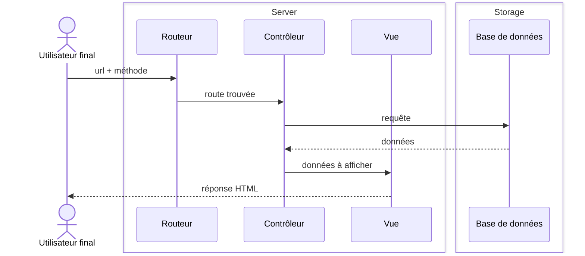

# 
## Le cycle de vie d'une requête dans votre framework, de l'arrivée HTTP à la réponse

## Le rôle de chaque classe et comment elles interagissent
## Comment l'injection de dépendances réduit le couplage
## Les limites de notre implémentation et les améliorations possibles